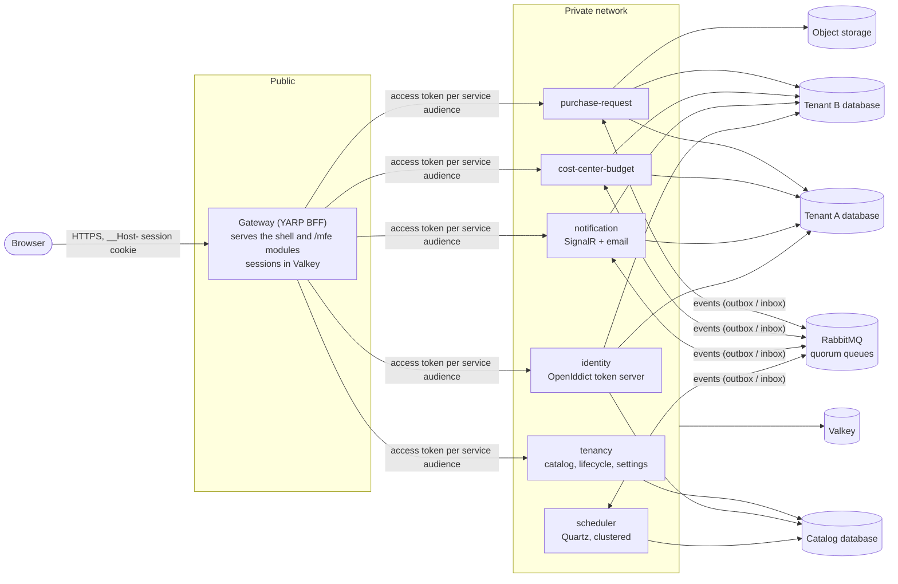

# Multi-tenant SaaS template

The starting point for every new product: a secure, multi-tenant, observable platform that runs from day one.
It follows `SAAS_TEMPLATE_PROMPT.md`; differences are recorded in [docs/deviations.md](docs/deviations.md).

A reusable starting point for a multi-tenant SaaS product: one database per tenant (SQL Server 2025; PostgreSQL 18 is supported and added back with `scripts/add-postgresql`), a module per
business capability (backend and frontend with the same key), per-tenant plans and customization, a BFF with no tokens in the browser,
and tests that enforce the architecture. A worked example (`purchase-request`, plus an add-on `cost-center-budget`) shows every pattern.

> **Single source of truth.** Every fact is defined once. The application's structure lives in
> [`platform.yaml`](platform.yaml); runtime configuration in the typed options records in `backend/src/Core/Configuration`.
> Edit the source, then run `scripts/generate.sh` (or `scripts/generate.ps1`). CI fails if generated files drift.

## Architecture



- **A tenant is a connection, not a filter.** Every request resolves a tenant (from the host name and the token), and the tenant decides
  which database the module's `DbContext` talks to. Business code never filters by tenant.
- **A module owns its schema.** No module reads another's tables; they talk through APIs and versioned events in `Contracts`
  (transactional outbox on the way out, inbox on the way in).
- **Hosting is a deployment choice.** Each module runs as its own service by default; `AllInOne.Host` runs them all in one process.
- **The browser holds no tokens.** The Gateway is the OAuth client; the browser gets an `HttpOnly` session cookie, and the Gateway gets a
  token per downstream service audience.
- **Everything about structure is generated.** `platform.yaml` lists the services and modules; `scripts/generate` writes constants,
  routes, the AppHost, the compose file, CI workflows, API clients and docs, and CI fails if they drift.

## Services and modules

<!-- BEGIN GENERATED: modules (<auto-generated> Edit platform.yaml instead and run scripts/generate.) -->
| Service | Route | Local port | Owns modules | Databases |
|---|---|---|---|---|
| `identity` | `/api/identity/*` | 5001 | `access-management` | tenant, catalog |
| `tenancy` | `/api/tenancy/*` | 5002 | `tenant-settings`, `billing` | catalog |
| `notification` | `/api/notification/*` | 5003 | — | tenant |
| `purchase-request` | `/api/purchase-request/*` | 5101 | `purchase-request` | tenant |
| `cost-center-budget` | `/api/cost-center-budget/*` | 5102 | `cost-center-budget` | tenant |

| Module | Name | Plans |
|---|---|---|
| `access-management` | Access Management | standard, plus |
| `tenant-settings` | Tenant Settings | standard, plus |
| `billing` | Billing | standard, plus |
| `purchase-request` | Purchase Requests | standard, plus |
| `cost-center-budget` | Cost Center Budget | plus |
<!-- END GENERATED: modules -->

## Quick start

Prerequisites: .NET SDK 10 (see `global.json`), Docker (on Apple Silicon, Docker Desktop with Rosetta emulation, which SQL Server
needs), Node.js 24 and pnpm (`corepack enable pnpm`), and [mkcert](https://github.com/FiloSottile/mkcert) for local HTTPS
(`scripts/dev-up` installs it with Homebrew if it can).

```sh
scripts/dev-up                # certificate, frontend build, the whole stack, migrations, both demo tenants with sample data
```

It prints the two tenants, `https://demo.localhost:7443/` (Standard plan, defaults) and `https://demo-plus.localhost:7443/` (Plus
plan, customised), and each tenant's admin invitation link: open it, choose a password, sign in, and compare what the two tenants see
([docs/tenant-customization.md](docs/tenant-customization.md) explains each difference).

```sh
scripts/add-postgresql                   # once: restores the PostgreSQL migrations (platform.yaml then lists both providers)
scripts/dev-up --provider postgresql     # the same stack on PostgreSQL 18 (one configuration value: Database:Provider)
scripts/dev-up --all-in-one              # every module in one process
scripts/onboard-tenant acme-co --plan plus   # another isolated tenant in the running stack
scripts/dev-down [--reset]               # stop (and, with --reset, delete the local data)
```

Run the checks:

```sh
dotnet test --solution backend/acme.slnx     # unit, architecture, scenario and integration tests on every database provider in platform.yaml (Docker required)
cd frontend && pnpm install && pnpm typecheck lint test build && pnpm e2e    # Playwright against the built app (mocked API)
cd frontend && pnpm e2e:stack                # the scenario against the running stack (after scripts/dev-up)
scripts/generate.sh --check                  # nothing generated has drifted from its source
scripts/check-licenses.sh                    # the license policy
```

Without Aspire, `deploy/docker-compose.yml` (published from the AppHost) runs the same stack; its variables are listed in
`deploy/compose.env.example`. Configuration keys are in [docs/configuration.md](docs/configuration.md) (generated).

## Where things are

```
platform.yaml                 the single source for structure
backend/src/Core*             the shared kernel: tenancy, data (SQL Server and PostgreSQL providers), messaging, security, files, observability
backend/src/Contracts         versioned events and the settings / flag declarations modules share
backend/src/Modules/*         one class library per module: Domain, Application, Infrastructure, Api
backend/src/Hosts/*           a thin host per module, and AllInOne.Host
backend/src/{Gateway,Scheduler,Migrator,AppHost,DevSeed}
backend/tests/*               architecture, core, identity, integration (Testcontainers) and the shared TestSupport
frontend/apps/shell           the host app; frontend/modules/* federated modules; frontend/packages/{ui-kit,web-core,api-clients}
templates/                    the clean module templates scripts/new-module instantiates
deploy/                       compose (generated), Dockerfiles, cloud placeholder
docs/                         guides, ADRs, runbooks, the generated configuration, event and design-system references, deviations
```

## Guides

- [Adding a module](docs/adding-a-module.md) · [Onboarding a tenant](docs/onboarding-a-tenant.md) · [Tenant customization](docs/tenant-customization.md)
- [Architecture decisions](docs/adr/README.md) · [Runbooks](docs/runbooks/README.md) · [SLOs](docs/runbooks/slos.md)
- [Deviations from the specification](docs/deviations.md)

## Extracting a module into its own repository

Nothing in a module depends on its neighbours, so it can move without code changes:

- **Backend module**: copy `backend/src/Modules/{Name}`, `backend/src/Modules/{Name}.Migrations.*`, `backend/src/Hosts/{Name}.Host` and
  `backend/tests/{Name}.Tests` to the new repository's `backend/` tree (with `Core`, `Contracts`, `Directory.*` and `TestSupport` as a
  package or submodule, since `Core` is packable), keep its entry in the product's `platform.yaml`, and build its image from
  `deploy/docker/service.Dockerfile`. Events and settings are in `Contracts`, which stays shared and versioned.
- **Frontend module**: copy `frontend/modules/{key}`. It depends only on `@acme/ui-kit`, `@acme/web-core` and `@acme/api-clients`
  (publish them to a private registry), and a tenant's manifest points at its `mf-manifest.json` wherever it is hosted; the
  catalog stores the version, the base URL is configuration. No other module or the shell imports it.

## License

Apache License 2.0 (see `LICENSE`). Dependencies follow the license policy in `SAAS_TEMPLATE_PROMPT.md` section 1; `scripts/check-licenses` enforces it.
