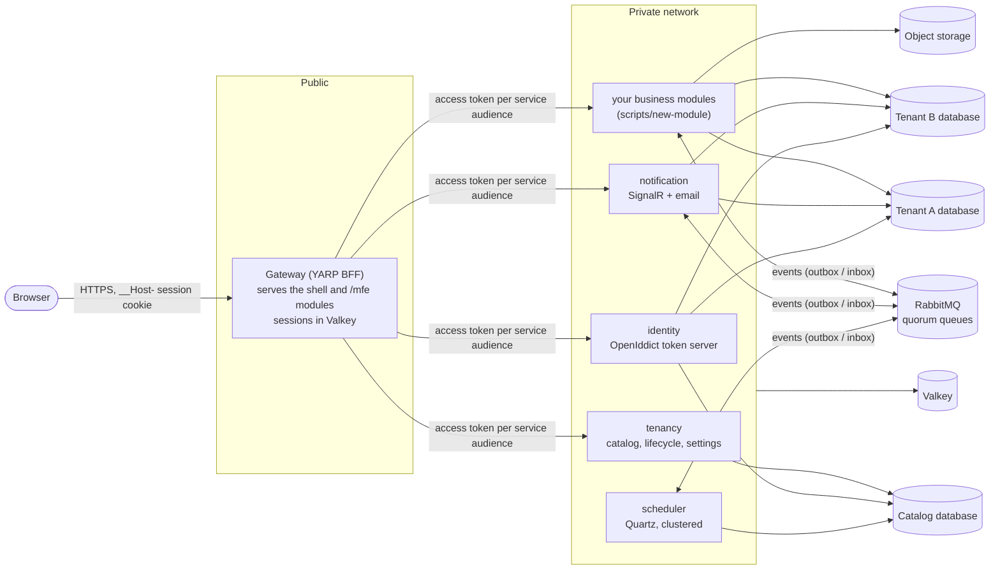

# Multi-tenant SaaS template

The starting point for every new product: a secure, multi-tenant, observable platform that runs from day one.
It follows `SAAS_TEMPLATE_PROMPT.md`; differences are recorded in [docs/deviations.md](docs/deviations.md).

A reusable starting point for a multi-tenant SaaS product: one database per tenant (SQL Server 2025; PostgreSQL 18 is supported and added back with `scripts/add-postgresql`), a module per
business capability (backend and frontend with the same key), per-tenant plans and customization, a BFF with no tokens in the browser,
and tests that enforce the architecture. It ships **no business module**: you add yours with `scripts/new-module`, from clean templates
that show every pattern.


> **Single source of truth.** Every fact is defined once. The application's structure lives in
> [`platform.yaml`](platform.yaml); runtime configuration in the typed options records in `backend/src/Core/Configuration`.
> Edit the source, then run `scripts/generate.sh` (or `scripts/generate.ps1`). `scripts/generate --check` fails if generated files drift.

## Architecture



- **A tenant is a connection, not a filter.** Every request resolves a tenant (from the host name and the token), and the tenant decides
  which database the module's `DbContext` talks to. Business code never filters by tenant.
- **A module owns its schema.** No module reads another's tables; they talk through APIs and versioned events in `Contracts`
  (transactional outbox on the way out, inbox on the way in).
- **Hosting is a deployment choice.** Each module runs as its own service by default; `AllInOne.Host` runs them all in one process.
- **The browser holds no tokens.** The Gateway is the OAuth client; the browser gets an `HttpOnly` session cookie, and the Gateway gets a
  token per downstream service audience.
- **Everything about structure is generated.** `platform.yaml` lists the services and modules; `scripts/generate` writes constants,
  routes, the AppHost, the compose file, the CI workflow, API clients and docs, and `scripts/generate --check` fails if they drift.

## Services and modules

<!-- BEGIN GENERATED: modules (<auto-generated> Edit platform.yaml instead and run scripts/generate.) -->
| Service | Route | Local port | Owns modules | Databases |
|---|---|---|---|---|
| `identity` | `/api/identity/*` | 5001 | `access-management` | tenant, catalog |
| `tenancy` | `/api/tenancy/*` | 5002 | `tenant-settings`, `billing` | catalog |
| `notification` | `/api/notification/*` | 5003 | — | tenant |
| `master-data` | `/api/master-data/*` | 5101 | `master-data` | tenant |

| Module | Name | Plans |
|---|---|---|
| `access-management` | Access Management | lite, standard, plus |
| `tenant-settings` | Tenant Settings | lite, standard, plus |
| `billing` | Billing | lite, standard, plus |
| `master-data` | Master Data | lite, standard, plus |
<!-- END GENERATED: modules -->

## Quick start

### Prerequisites

`scripts/dev-up` checks for the tools below and stops with a message if one is missing. Install them once.

| Tool | Version | Why | Windows (winget) |
|---|---|---|---|
| [.NET SDK](https://dotnet.microsoft.com/download) | 10 (`global.json` pins 10.0.102 or a later 10.0 feature band) | builds and runs the backend and the Aspire AppHost | `winget install Microsoft.DotNet.SDK.10` |
| [Docker Desktop](https://www.docker.com/products/docker-desktop/) | current, **running**, Linux containers | SQL Server, RabbitMQ, Valkey, Mailpit and Azurite run as containers | `winget install Docker.DockerDesktop` |
| [Node.js](https://nodejs.org/) | **24 or later** (`frontend/package.json` requires it) | frontend build; the generator also reads the TypeScript design tokens with it | `winget install OpenJS.NodeJS.LTS` |
| pnpm | 12.x (pinned by `packageManager`) | frontend workspace | `npm install -g pnpm` (see below) |
| [mkcert](https://github.com/FiloSottile/mkcert) | any | a locally trusted HTTPS certificate for `localhost` and `*.localhost` | `winget install FiloSottile.mkcert` |
| Git | any | clone and update the repository | `winget install Git.Git` |

Optional: the Aspire CLI (`aspire`), only for `scripts/generate` without `--skip-compose` (it publishes
`deploy/docker-compose.yml`). Without it, run `scripts/generate --skip-compose`.

**One-time setup after installing**

```powershell
# pnpm. This works on every Node version and needs no administrator rights.
npm install -g pnpm

# Alternative: corepack. Node 25 and later no longer include it ("npm install -g corepack" first), and a Node installed under
# C:\Program Files needs an administrator terminal, otherwise it fails with "EPERM: operation not permitted".
# corepack enable pnpm

# Trust the local certificate authority, so browsers accept https://*.localhost. Run once.
mkcert -install

# Windows blocks unsigned scripts by default. If dev-up.ps1 is refused:
Set-ExecutionPolicy -Scope CurrentUser RemoteSigned
```

> **Restart your terminal, and VS Code, after installing.** A program reads `PATH` once, when it starts, so a terminal that was open
> during the install says a tool "is not recognized" even though it is installed. In VS Code, a new terminal tab is **not**
> enough, and neither is "Developer: Reload Window": VS Code's terminals inherit the environment VS Code itself started with. Quit
> VS Code completely (File > Exit, so every window closes) and open it again. Without restarting, refresh the current
> PowerShell window with:
>
> ```powershell
> $env:Path = [Environment]::GetEnvironmentVariable('Path','Machine') + ';' + [Environment]::GetEnvironmentVariable('Path','User')
> ```

Then check:

```powershell
dotnet --version     # 10.0.x
docker info          # prints server details, so Docker Desktop is running
node --version       # v24 or later
pnpm --version       # 12.x
mkcert -version      # v1.4.x
```

**Resources and ports**

- SQL Server alone needs 2 GB of memory in Docker; we recommend giving Docker Desktop 6 GB or more and keeping several GB of free
  disk for the images. The first start pulls the images and builds the frontend, so it can take several minutes (the script waits up
  to 20).
- These ports must be free: `7443` (Gateway, HTTPS), `15100` (Aspire dashboard), `8025` (Mailpit), and the service ports in
  `platform.yaml` (`5001`-`5003`, `5101`-`5102`).
- `*.localhost` names (such as `demo.localhost`) resolve to your own machine in Chrome and Edge; no hosts-file entry is needed.
- On macOS and Linux use `scripts/dev-up` (the shell script). It installs mkcert with Homebrew when it can and runs `mkcert -install`
  for you. On Apple Silicon, Docker Desktop needs Rosetta emulation enabled, which SQL Server requires.

### Start the stack

```sh
scripts/dev-up                # certificate, frontend build, the whole stack, migrations, the demo tenant
```

On Windows run `scripts/dev-up.ps1` from PowerShell (Windows PowerShell 5.1 and PowerShell 7 both work).

**What can go wrong**

| Symptom | Cause and fix |
|---|---|
| `... is not recognized` for `mkcert`, `pnpm`, `node`, `docker` | The terminal started before the install. Restart it and VS Code (see above). |
| `EPERM: operation not permitted` from `corepack enable pnpm` | Node lives under `C:\Program Files`. Use `npm install -g pnpm` instead. |
| A "Windows Security" dialog about a certificate | That is `mkcert -install` adding your local CA to the trusted roots. Click **Yes**. |
| The browser warns about `https://demo.localhost:7443` | The local CA is not trusted yet: run `mkcert -install` and restart the browser. |
| The script waits a long time at "Waiting for the Gateway" | The first start pulls several images and restores packages (up to 20 minutes). Watch `.dev/apphost.log` and the Docker Desktop containers. If nothing starts, check that Docker Desktop is running. |
| A Windows Firewall prompt for `dotnet` | Allow it on private networks; the services listen on localhost. |
| A port is already in use (`7443`, `15100`, `8025`, `5001`-`5003`, `5101`-`5102`) | Stop what uses it (`netstat -ano \| findstr :7443`), or run `scripts/dev-down.ps1` if it is a previous run of this stack. |
| SQL Server container exits at once | Docker has too little memory (it needs 2 GB). Raise it in Docker Desktop, Settings, Resources. |

It prints the demo tenant and its admin invitation link. There are no default passwords: you choose one from the link.

### First sign-in

| Tenant | Address | Plan | Admin account (the only seeded user) |
|---|---|---|---|
| `demo` (Demo Co) | `https://demo.localhost:7443/` | The first plan in `platform.yaml` | `admin@demo.example` |

Every tenant has its own database and its own accounts. The `.example` addresses are not real mailboxes. Add more tenants with
`scripts/onboard-tenant <slug> --plan <plan>`.

1. **Copy the invitation link** that `dev-up` printed. It is also saved in `.dev/invitations.json` (git-ignored). It looks like
   `https://login.localhost:7443/account/invitation?tenant=demo&token=...`, and it is single-use and short-lived.
2. **Open it in your browser.** You see "Choose a password" for that tenant.
3. **Type a new password and press "Save password".** Rules: at least **15 characters** (8 once the account has a second factor),
   no required digits or symbols, and it must not appear in a known data breach. A passphrase of four or five words works well.
   The breach check calls the public Have I Been Pwned range API; offline, only the length rule applies.
4. **Sign in.** After saving, you are taken to the sign-in page (on `login.localhost`). Enter the admin email and your new
   password; you are then sent to your tenant's address (`https://demo.localhost:7443/`) and land on its home page. To sign in
   later, open the tenant address directly. The link works once.

Things to know:

- **No email is sent in development.** Invitation and password-reset links are written to the Identity service's log, not to
  Mailpit. If you lose a link, or use "Forgot password" on the sign-in page, open the Aspire dashboard
  (`http://localhost:15100`), choose the `identity` resource, open its console logs and search for `Account link`.
- **"This invitation is not valid any more"** means the link was used or expired. For a clean local start run
  `scripts/dev-down.ps1 -Reset` and then `scripts/dev-up.ps1`, which seeds the tenants again with new links.
- **Platform operator (no screen yet).** `dev-up` also creates a development operator, `dev-operator@example.com`, and saves
  its password and TOTP key in `.dev/operator.json`. It is for the operator API (onboarding and managing tenants), not for the
  tenant sign-in pages above. Never reuse it outside development.
- **Other users and roles.** Roles are `user`, `manager` and `admin`, per module.
  There is no screen for managing users yet: the seeded admin invites and assigns roles through the Identity access-management
  API (`/api/identity/v1/principals`; the OpenAPI document is `frontend/packages/api-clients/openapi/identity.json`).

```sh
scripts/add-postgresql                   # once: restores the PostgreSQL migrations (platform.yaml then lists both providers)
scripts/dev-up --provider postgresql     # the same stack on PostgreSQL 18 (one configuration value: Database:Provider)
scripts/dev-up --all-in-one              # every module in one process
scripts/onboard-tenant farm360-co --plan plus   # another isolated tenant in the running stack
scripts/dev-down [--reset]               # stop (and, with --reset, delete the local data)
```

Run the checks:

```sh
dotnet test --solution backend/farm360.slnx     # unit, architecture and integration tests on every database provider in platform.yaml (Docker required)
cd frontend && pnpm install && pnpm typecheck lint test build && pnpm e2e    # Playwright against the built app (mocked API)
cd frontend && pnpm e2e:stack                # sign-in against the running stack (after scripts/dev-up)
scripts/generate.sh --check                  # nothing generated has drifted from its source
scripts/check-licenses.sh                    # the license policy
```

Without Aspire, `deploy/docker-compose.yml` (published from the AppHost) runs the same stack; its variables are listed in
`deploy/compose.env.example`. Configuration keys are in [docs/configuration.md](docs/configuration.md) (generated).

## Where things are

```
platform.yaml                 the single source for structure
backend/src/Core*             the shared kernel: tenancy, data (SQL Server and PostgreSQL providers), messaging, security, files, observability
backend/src/Contracts         versioned events and the settings / flag declarations modules share
backend/src/Modules/*         one class library per module: Domain, Application, Infrastructure, Api
backend/src/Hosts/*           a thin host per module, and AllInOne.Host
backend/src/{Gateway,Scheduler,Migrator,AppHost,DevSeed}
backend/tests/*               architecture, core, identity, integration (Testcontainers) and the shared TestSupport
frontend/apps/shell           the host app; frontend/modules/* federated modules; frontend/packages/{ui-kit,web-core,api-clients}
templates/                    the clean module templates scripts/new-module instantiates
deploy/                       compose (generated), Dockerfiles, cloud placeholder
docs/                         guides, ADRs, runbooks, the generated configuration, event and design-system references, deviations
```

## Guides

- [Adding a module](docs/adding-a-module.md) · [Onboarding a tenant](docs/onboarding-a-tenant.md) · [Tenant customization](docs/tenant-customization.md)
- [Architecture decisions](docs/adr/README.md) · [Runbooks](docs/runbooks/README.md) · [SLOs](docs/runbooks/slos.md)
- [Deviations from the specification](docs/deviations.md)

## Extracting a module into its own repository

Nothing in a module depends on its neighbours, so it can move without code changes:

- **Backend module**: copy `backend/src/Modules/{Name}`, `backend/src/Modules/{Name}.Migrations.*`, `backend/src/Hosts/{Name}.Host` and
  `backend/tests/{Name}.Tests` to the new repository's `backend/` tree (with `Core`, `Contracts`, `Directory.*` and `TestSupport` as a
  package or submodule, since `Core` is packable), keep its entry in the product's `platform.yaml`, and build its image from
  `deploy/docker/service.Dockerfile`. Events and settings are in `Contracts`, which stays shared and versioned.
- **Frontend module**: copy `frontend/modules/{key}`. It depends only on `@farm360/ui-kit`, `@farm360/web-core` and `@farm360/api-clients`
  (publish them to a private registry), and a tenant's manifest points at its `mf-manifest.json` wherever it is hosted; the
  catalog stores the version, the base URL is configuration. No other module or the shell imports it.

## License

Apache License 2.0 (see `LICENSE`). Dependencies follow the license policy in `SAAS_TEMPLATE_PROMPT.md` section 1; `scripts/check-licenses` enforces it.
