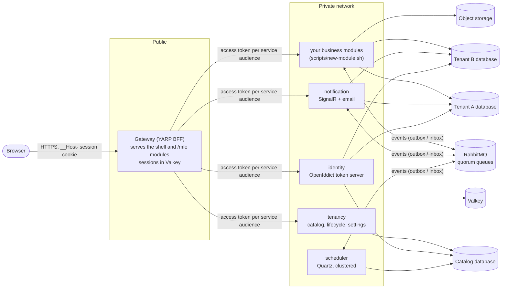

# Multi-tenant SaaS template

A starting point for a multi-tenant SaaS product. Each tenant has its own database, each business capability is a module (backend and
frontend share one key), and the browser never holds a token. Tests enforce the architecture.

**What you get**

- A platform that runs from day one: Gateway (BFF), Identity (OpenIddict token server), Tenancy, Notification and Scheduler services.
- One empty business module, **Base**, for your master data (`MsFarm`, `MsCrop`, ...). You add the others with `scripts/new-module.sh`.
- A customer app: sign-in, users, groups, devices, applications, module roles, branding and languages (English, Malay, Chinese).
- An operator console: onboard tenants, manage plans, modules, principals, sign-in provider settings, support requests and tenant lifecycle.
- Per-tenant plans and customization (settings, feature flags, custom fields, slots), without forks or `if (tenant == ...)`.
- Generators: `platform.yaml` is the single source for structure; `scripts/generate.sh` writes the code, routes, compose file, CI and docs from it.
- Runbooks, ADRs and a list of [known limitations](docs/known-limitations.md). Read that list before you rely on a feature.

SQL Server 2025 is the supported database. PostgreSQL is not supported in this release ([ADR 0011](docs/adr/0011-sql-server-and-postgresql.md)).

## Prerequisites

`scripts/dev-up.sh` and `scripts/dev-up.ps1` check for these tools and stop with a message if one is missing.

| Tool | Version | Why | Windows (winget) |
|---|---|---|---|
| [.NET SDK](https://dotnet.microsoft.com/download) | 10 (`global.json` pins 10.0.102 or a later 10.0 feature band) | builds and runs the backend and the Aspire AppHost | `winget install Microsoft.DotNet.SDK.10` |
| [Docker Desktop](https://www.docker.com/products/docker-desktop/) | current, **running**, Linux containers | SQL Server, RabbitMQ, Valkey, Mailpit and Azurite run as containers | `winget install Docker.DockerDesktop` |
| [Node.js](https://nodejs.org/) | **24 or later** (`frontend/package.json` requires it) | frontend build; the generator also reads the TypeScript design tokens with it | `winget install OpenJS.NodeJS.LTS` |
| pnpm | 12.x (pinned by `packageManager`) | frontend workspace | `npm install -g pnpm` |
| [mkcert](https://github.com/FiloSottile/mkcert) | any | a locally trusted HTTPS certificate for `localhost` and `*.localhost` | `winget install FiloSottile.mkcert` |
| Git | any | clone and update the repository | `winget install Git.Git` |

Optional: the Aspire CLI (`aspire`). The generator needs it to publish `deploy/docker-compose.yml`. Without it, add `--skip-compose`
to the generate commands.

After installing, once:

```sh
npm install -g pnpm     # works on every Node version and needs no administrator rights
mkcert -install         # trusts the local certificate authority, so browsers accept https://*.localhost
```

On Windows, if PowerShell refuses the scripts: `Set-ExecutionPolicy -Scope CurrentUser RemoteSigned`.

> **Restart your terminal, and VS Code, after installing.** A program reads `PATH` once, when it starts, so a terminal that was open
> during the install says a tool "is not recognized". In VS Code, a new terminal tab is not enough, and neither is "Developer: Reload
> Window". Quit VS Code completely (File > Exit) and open it again. Without restarting, refresh the current PowerShell window with:
>
> ```powershell
> $env:Path = [Environment]::GetEnvironmentVariable('Path','Machine') + ';' + [Environment]::GetEnvironmentVariable('Path','User')
> ```

Check the tools:

```sh
dotnet --version     # 10.0.x
docker info          # prints server details, so Docker Desktop is running
node --version       # v24 or later
pnpm --version       # 12.x
mkcert -version      # v1.4.x
```

**Resources and ports**

- SQL Server needs 2 GB of memory in Docker. Give Docker Desktop 6 GB or more, and keep several GB of disk free for the images.
  On Apple Silicon, enable Rosetta emulation in Docker Desktop (SQL Server requires it).
- The first start pulls images and builds the frontend. It can take several minutes; the script waits up to 20.
- These ports must be free: `7443` (Gateway, HTTPS), `15100` (Aspire dashboard), `8025` (Mailpit), and the service ports in `platform.yaml`
  (`5001`-`5003`, `5101`).
- `*.localhost` names (such as `demo.localhost`) resolve to your own machine in Chrome and Edge. No hosts-file entry is needed.

<!-- BEGIN TEMPLATE ONLY -->
## Create your product

1. Make a copy: **Use this template** on GitHub, or `git clone` it into a folder named after your product.
2. Install the [prerequisites](#prerequisites).
3. Run the generator. It scaffolds the product and asks for anything you don't pass:

   ```sh
   scripts/generate.sh --product farm360 --org "CodeX Studio" --modules crop-planning,livestock      # macOS and Linux
   scripts/generate.ps1 --product farm360 --org "CodeX Studio" --modules crop-planning,livestock     # Windows
   ```

   It writes your answers into `platform.yaml`, renames the template's placeholder (`saaskit`, `Saaskit`, `@saaskit/*`) to your product
   everywhere, adds the first business modules (backend, frontend, migrations, CI), generates everything, installs, builds and checks,
   removes what only the template needs, and makes the first commit. If a step fails, fix it and run the same command again: it continues
   where it stopped.

   | Option | Default | Meaning |
   |---|---|---|
   | `--product` | asked | The product key: lowercase letters and digits (`farm360`). It becomes the C# root namespace (`Farm360.Core`), the npm scope (`@farm360/ui-kit`), token audiences and container names. |
   | `--org` | `CodeX Studio` | The organization, for package metadata. |
   | `--timezone`, `--currency`, `--locales` | `Asia/Kuala_Lumpur`, `MYR`, `en,ms,zh` | Defaults for new tenants. |
   | `--plans` | `lite,advanced,complete` | The plans you sell, lowest first (the template's own). `platform.yaml` seeds the first plans; the operator console manages them afterwards. |
   | `--cloud` | `azure` | `azure` or `aws`. |
   | `--modules` | none | The first business modules, as keys (`crop-planning,livestock`). Add more later with `scripts/new-module.sh`. |
   | `--yes` | | Ask nothing; use the defaults for what isn't passed (`--product` is still required). |
   | `--skip-checks`, `--no-git` | | Skip the build and checks; don't commit. |

4. [Run it locally](#run-it-locally).

Maintaining the template itself: `scripts/generate.sh --template` regenerates it without scaffolding, and `--check` never scaffolds.
<!-- END TEMPLATE ONLY -->

## Run it locally

```sh
scripts/dev-up.sh       # macOS and Linux
scripts/dev-up.ps1      # Windows (Windows PowerShell 5.1 and PowerShell 7 both work)
```

It makes the certificate, builds the frontend, starts the whole stack, applies the migrations and creates the `demo` tenant. At the end it
prints the tenant's address and its first admin's invitation link. The invitation is also saved in `.dev/invitations.json` (git-ignored).

| Option | macOS and Linux | Windows |
|---|---|---|
| Every module in one process | `--all-in-one` | `-AllInOne` |
| Skip the frontend build | `--no-build` | `-NoBuild` |

| What | Address |
|---|---|
| Customer app (demo tenant) | `https://demo.localhost:7443/` |
| Operator console | `https://operator.localhost:7443/` |
| Aspire dashboard (logs, traces, metrics) | `http://localhost:15100` |
| Mailpit | `http://localhost:8025` |

**What can go wrong**

| Symptom | Cause and fix |
|---|---|
| `... is not recognized` for `mkcert`, `pnpm`, `node`, `docker` | The terminal started before the install. Restart it and VS Code (see above). |
| `EPERM: operation not permitted` from `corepack enable pnpm` | Node lives under `C:\Program Files`. Use `npm install -g pnpm` instead. |
| A "Windows Security" dialog about a certificate | That is `mkcert -install` adding your local CA to the trusted roots. Click **Yes**. |
| The browser warns about `https://demo.localhost:7443` | The local CA is not trusted yet: run `mkcert -install` and restart the browser. |
| The script waits a long time at "Waiting for the Gateway" | The first start pulls several images and restores packages (up to 20 minutes). Watch `.dev/apphost.log` and the containers in Docker Desktop. If nothing starts, check that Docker Desktop is running. |
| A Windows Firewall prompt for `dotnet` | Allow it on private networks; the services listen on localhost. |
| A port is already in use | Stop what uses it (`netstat -ano \| findstr :7443` on Windows, `lsof -i :7443` elsewhere), or stop a previous run of this stack with `scripts/dev-down.sh` (`scripts/dev-down.ps1`). |
| SQL Server container exits at once | Docker has too little memory (it needs 2 GB). Raise it in Docker Desktop, Settings, Resources. |
| The migrator fails with "There is already an object named ..." | The local databases come from an earlier copy of this product. Start clean: `scripts/dev-down.sh --reset` (`scripts/dev-down.ps1 -Reset`). This deletes the local data. |

## First sign-in

**Customer admin.** The `demo` tenant has one seeded user, `admin@demo.example`. There are no default passwords.

1. Open the invitation link that `scripts/dev-up.sh` printed (`https://login.localhost:7443/account/invitation?tenant=demo&token=...`).
   It is single-use and short-lived.
2. Choose a password and press **Save password**. It needs at least 15 characters (8 once the account has a second factor), no required
   digits or symbols, and must not appear in a known data breach. A passphrase of four or five words works well. The breach check calls
   the public Have I Been Pwned range API; offline, only the length rule applies.
3. Sign in with `admin@demo.example` and your password. You land on `https://demo.localhost:7443/`. To sign in later, open that address.

No email is sent in this release. Invitation and password-reset links are written to the Identity service's log: open the Aspire
dashboard (`http://localhost:15100`), choose the `identity` resource, open its console logs and search for `Account link`. An
invitation that "is not valid any more" was used or has expired: run `scripts/dev-down.sh --reset` (`scripts/dev-down.ps1 -Reset`) and
`dev-up` again for new links. The `.example` addresses are not real mailboxes.

**Operator.** `dev-up` creates a development operator, `dev-operator@example.com`, and saves its password and authenticator key in
`.dev/operator.json` (git-ignored). Open `https://operator.localhost:7443/`, add the key to an authenticator app, and sign in with the
email, the password and the 6-digit code. Never reuse these details outside development.

## Everyday commands

| Task | macOS and Linux | Windows |
|---|---|---|
| Start the stack | `scripts/dev-up.sh` | `scripts/dev-up.ps1` |
| Stop it | `scripts/dev-down.sh` | `scripts/dev-down.ps1` |
| Stop it and delete the local data | `scripts/dev-down.sh --reset` | `scripts/dev-down.ps1 -Reset` |
| Add a tenant to the running stack | `scripts/onboard-tenant.sh north-co --plan advanced` | `scripts/onboard-tenant.ps1 north-co --plan advanced` |
| Add a business module | `scripts/new-module.sh <key>` | `scripts/new-module.ps1 <key>` |
| Regenerate what `platform.yaml` drives | `scripts/generate.sh` | `scripts/generate.ps1` |
| Check nothing generated has drifted | `scripts/generate.sh --check` | `scripts/generate.ps1 --check` |
| Check the license policy | `scripts/check-licenses.sh` | `scripts/check-licenses.ps1` |

`scripts/onboard-tenant` also takes `--name "Display Name"` and `--admin-email you@example.com`. The `--plan` value is a plan key
(`lite`, `advanced` or `complete` in the template). The generate scripts also take `--skip-compose` (leave `deploy/docker-compose.yml`
alone) and `--skip-api` (skip the OpenAPI export and typed clients).

## Build features

- [Add a module](docs/adding-a-module.md): one command creates the backend, host, migrations, tests and frontend, and wires them in.
- [Add a master entity](docs/adding-a-master-entity.md): `MsFarm` in Base, from the table to the screen.
- [Onboard a tenant](docs/onboarding-a-tenant.md): what the pipeline does, and how isolation is checked.
- [Customize per tenant](docs/tenant-customization.md): settings, flags, strategies, custom fields, events, slots and add-on modules.

## Test

```sh
dotnet test --solution backend/saaskit.slnx     # unit, architecture and integration tests (Docker required)
cd frontend
pnpm install
pnpm typecheck && pnpm lint && pnpm test && pnpm build
pnpm --filter @saaskit/e2e exec playwright install chromium    # once, for the browser tests
pnpm e2e                                         # Playwright against the built app, with the API mocked
pnpm e2e:stack                                   # Playwright against the running stack (run scripts/dev-up.sh first)
```

The same commands work in PowerShell. `pnpm e2e` needs `pnpm build` first.

## Deploy

`deploy/docker-compose.yml` is published from the AppHost by `scripts/generate.sh`. It runs the whole stack on one machine from container
images. It is not a cloud deployment: the cloud setup is left to each product.

1. **Stop the local stack and clear its data** (`scripts/dev-down.sh --reset`). The compose file uses the same volume names.
2. **Build the images** from the repository root, one per service. The service image takes the project and the assembly name
   (`{Product}.{Host}.dll`):

   ```sh
   docker build -f deploy/docker/service.Dockerfile \
     --build-arg PROJECT=backend/src/Hosts/Identity.Host/Identity.Host.csproj \
     --build-arg ASSEMBLY=Saaskit.Identity.Host.dll -t saaskit-identity .
   docker build -f deploy/docker/gateway.Dockerfile -t saaskit-gateway .
   ```

   Do the same for every service in the table below (`Tenancy.Host`, `Notification.Host`, `Base.Host`, and any module you add), for
   `backend/src/Scheduler/Scheduler.csproj` (`Saaskit.Scheduler.dll`) and for `backend/src/Migrator/Migrator.csproj` (`Saaskit.Migrator.dll`).
3. **Fill in the variables.** Copy `deploy/compose.env.example` to `deploy/.env` and give every variable a value: the `*_IMAGE` names from
   step 2, `*_PORT` as `8080` (`8443` for `GATEWAY_PORT`), long random passwords and secrets, `openssl rand -base64 32` for
   `DATA_PROTECTION_KEY` and `TOKEN_ENCRYPTION_KEY`, and a P-256 key for `TOKEN_SIGNING_KEY` (`openssl ecparam -name prime256v1 -genkey -noout`,
   in double quotes with `\n` for each line break). Never commit the file.
4. **Give the Gateway a certificate.** It serves HTTPS and the compose file supplies none, so it exits at start without one. Add a
   `deploy/docker-compose.override.yml` that mounts a certificate and key (for `*.localhost`, mkcert's from `.dev/certs` works) and sets
   `Kestrel__Certificates__Default__Path` and `Kestrel__Certificates__Default__KeyPath` for the `gateway` service.
5. **Start it:** `docker compose -f deploy/docker-compose.yml -f deploy/docker-compose.override.yml up -d`. The Gateway is on `https://localhost:7443/`.
6. **Create the first operator.** The migrator needs the Valkey and Data Protection settings for this:

   ```sh
   docker compose -f deploy/docker-compose.yml run --rm \
     -e "Redis__ConnectionString=valkey:6379,password=<VALKEY_PASSWORD>" -e "DataProtection__KeyEncryptionKey=<DATA_PROTECTION_KEY>" \
     migrator --create-operator you@example.com "Your Name"
   ```

   It prints a password and an authenticator key once. Then sign in at `https://operator.localhost:7443/` and onboard a tenant.

Configuration keys are in [docs/configuration.md](docs/configuration.md) (generated). Operations are in the [runbooks](docs/runbooks/README.md).

## Release

`.github/workflows/ci.yml` (generated from `platform.yaml`) is the only workflow. It runs on pushes to `main`, on pull requests and by
hand (`workflow_dispatch`). The backend job builds `backend/saaskit.slnx` in Release with warnings as errors. The frontend job installs
with `--frozen-lockfile`, then runs `typecheck`, `lint` and `build`.

CI does not run on tags and does not run the tests, `scripts/generate.sh --check` or `scripts/check-licenses.sh`. It publishes no images and
no packages. A release is therefore a manual step:

1. Run the [tests](#test), `scripts/generate.sh --check` and `scripts/check-licenses.sh` yourself.
2. Merge to `main` and wait for CI to pass.
3. Tag the commit (`git tag -a v0.1.0 -m "v0.1.0"`, then `git push origin v0.1.0`) and create the GitHub release from the matching
   section of [CHANGELOG.md](CHANGELOG.md).
4. Build and push your images ([Deploy](#deploy), step 2) if you deploy from a registry.

## Known limitations

Several features are not connected yet: the Google, Microsoft, Apple and Facebook buttons, billing, operator roles, using support
access from the console, and sending email. The full, checked list is in [docs/known-limitations.md](docs/known-limitations.md).

## Reference

> **Single source of truth.** Every fact is defined once. The application's structure lives in [`platform.yaml`](platform.yaml); runtime
> configuration in the typed options records in `backend/src/Core/Configuration`. Edit the source, then run `scripts/generate.sh`
> (`scripts/generate.ps1`). `scripts/generate.sh --check` fails if generated files drift.



- **A tenant is a connection, not a filter.** Every request resolves a tenant (from the host name and the token), and the tenant decides
  which database the module's `DbContext` talks to. Business code never filters by tenant.
- **A module owns its schema.** No module reads another's tables; they talk through APIs and versioned events in `Contracts`
  (transactional outbox on the way out, inbox on the way in).
- **Hosting is a deployment choice.** Each module runs as its own service by default; `AllInOne.Host` runs them all in one process.
- **The browser holds no tokens.** The Gateway is the OAuth client; the browser gets an `HttpOnly` session cookie, and the Gateway gets a
  token per downstream service audience.
- **Everything about structure is generated.** `platform.yaml` lists the services and modules; the generator writes constants, routes, the
  AppHost, the compose file, the CI workflow, API clients and docs.

### Services and modules

<!-- BEGIN GENERATED: modules (<auto-generated> Edit platform.yaml instead and run scripts/generate.) -->
| Service | Route | Local port | Owns modules | Databases |
|---|---|---|---|---|
| `identity` | `/api/identity/*` | 5001 | `access-management` | tenant, catalog |
| `tenancy` | `/api/tenancy/*` | 5002 | `tenant-settings`, `billing` | catalog |
| `notification` | `/api/notification/*` | 5003 | — | tenant |
| `base` | `/api/base/*` | 5101 | `base` | tenant |

| Module | Name | Plans |
|---|---|---|
| `access-management` | Access Management | lite, advanced, complete |
| `tenant-settings` | Tenant Settings | lite, advanced, complete |
| `billing` | Billing | lite, advanced, complete |
| `base` | Base | lite, advanced, complete |
<!-- END GENERATED: modules -->

### Where things are

```
platform.yaml                 the single source for structure
backend/src/Core*             the shared kernel: tenancy, data (SQL Server provider), messaging, security, files, observability
backend/src/Contracts         versioned events and the settings / flag declarations modules share
backend/src/Modules/*         one class library per module: Domain, Application, Infrastructure, Api
backend/src/Hosts/*           a thin host per module, and AllInOne.Host
backend/src/{Gateway,Scheduler,Migrator,AppHost,DevSeed}
backend/tests/*               architecture, core, identity, integration (Testcontainers), generator, and the shared TestSupport
backend/tools/*               the generator and the OpenAPI exporter
frontend/apps/*               the shell (the host app) and the operator console
frontend/modules/*            federated modules; frontend/packages/{ui-kit,web-core,api-clients} are shared
templates/                    the clean module templates scripts/new-module.sh instantiates
deploy/                       the generated compose file and its variables, and the Dockerfiles
docs/                         guides, ADRs, runbooks and the generated references (index: docs/README.md)
```

### Guides

[docs/README.md](docs/README.md) lists every guide in reading order: the four feature guides above, [known limitations](docs/known-limitations.md),
[architecture decisions](docs/adr/README.md), [runbooks](docs/runbooks/README.md) and the generated references. The frontend has its own
[README](frontend/README.md). Changes by release are in [CHANGELOG.md](CHANGELOG.md).

### Extracting a module into its own repository

Nothing in a module depends on its neighbours, so it can move without code changes:

- **Backend module**: copy `backend/src/Modules/{Name}`, `backend/src/Modules/{Name}.Migrations.*`, `backend/src/Hosts/{Name}.Host` and
  `backend/tests/{Name}.Tests` to the new repository's `backend/` tree (with `Core`, `Contracts`, `Directory.*` and `TestSupport` as a
  package or submodule, since `Core` is packable), keep its entry in the product's `platform.yaml`, and build its image from
  `deploy/docker/service.Dockerfile`. Events and settings are in `Contracts`, which stays shared and versioned.
- **Frontend module**: copy `frontend/modules/{key}`. It depends only on `@saaskit/ui-kit`, `@saaskit/web-core` and `@saaskit/api-clients`
  (publish them to a private registry), and a tenant's manifest points at its `mf-manifest.json` wherever it is hosted; the
  catalog stores the version, the base URL is configuration. No other module or the shell imports it.

## License

Apache License 2.0 (see `LICENSE`). Dependencies follow the policy in [ADR 0023](docs/adr/0023-license-policy.md); `scripts/check-licenses.sh`
(`scripts/check-licenses.ps1`) enforces it.
